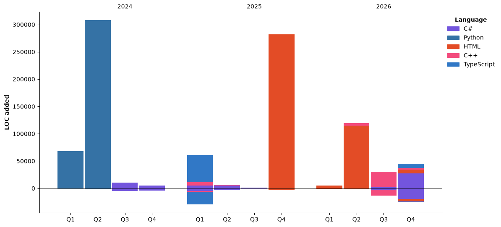

# Artur Semenets (`Misterbooom`)

**IT student · Gdańsk, Poland**  
Building compilers, embedded firmware, and low-level software.

## About

- Writing a compiled object-oriented language in C# with LLVM and a C runtime
- Developing ESP32-S3 hardware projects with LVGL and BLE/serial telemetry
- Interested in systems programming, compiler internals, embedded systems, and Linux tooling

## Tech Stack


## Featured Projects

### [BifyLang](https://github.com/Misterbooom/BifyLang)
A compiled object-oriented programming language built with C#, LLVM, and a C runtime.

**Focus:** compiler design · LLVM IR · language runtime · native code generation

### [Round-Display](https://github.com/Misterbooom/Round-Display)
ESP32-S3 desktop display project built with LVGL and BLE/serial telemetry.

**Focus:** embedded firmware · LVGL UI · ESP32-S3 · wireless and serial communication

## Development Stats

<!--START_SECTION:waka-->


**🐱 My GitHub Data** 

> 📦 ? Used in GitHub's Storage 
 > 
> 🏆 73 Contributions in the Year 2026
 > 
> 🚫 Not Opted to Hire
 > 
> 📜 6 Public Repositories 
 > 
> 🔑 0 Private Repositories 
 > 
**I'm an Early 🐤** 

```text
🌞 Morning                41 commits          ██░░░░░░░░░░░░░░░░░░░░░░░   07.02 % 
🌆 Daytime                258 commits         ███████████░░░░░░░░░░░░░░   44.18 % 
🌃 Evening                256 commits         ███████████░░░░░░░░░░░░░░   43.84 % 
🌙 Night                  29 commits          █░░░░░░░░░░░░░░░░░░░░░░░░   04.97 % 
```
📅 **I'm Most Productive on Sunday** 

```text
Monday                   87 commits          ████░░░░░░░░░░░░░░░░░░░░░   14.90 % 
Tuesday                  53 commits          ██░░░░░░░░░░░░░░░░░░░░░░░   09.08 % 
Wednesday                132 commits         ██████░░░░░░░░░░░░░░░░░░░   22.60 % 
Thursday                 52 commits          ██░░░░░░░░░░░░░░░░░░░░░░░   08.90 % 
Friday                   42 commits          ██░░░░░░░░░░░░░░░░░░░░░░░   07.19 % 
Saturday                 85 commits          ████░░░░░░░░░░░░░░░░░░░░░   14.55 % 
Sunday                   133 commits         ██████░░░░░░░░░░░░░░░░░░░   22.77 % 
```


📊 **This Week I Spent My Time On** 

```text
🕑︎ Time Zone: Europe/Warsaw

💬 Programming Languages: 
Other                    24 hrs 45 mins      ████████████░░░░░░░░░░░░░   48.95 % 
C#                       19 hrs 3 mins       █████████░░░░░░░░░░░░░░░░   37.67 % 
Text                     4 hrs 25 mins       ██░░░░░░░░░░░░░░░░░░░░░░░   08.73 % 
textmate                 1 hr 2 mins         █░░░░░░░░░░░░░░░░░░░░░░░░   02.06 % 
Markdown                 28 mins             ░░░░░░░░░░░░░░░░░░░░░░░░░   00.94 % 

🔥 Editors: 
Firefox                  26 hrs 34 mins      █████████████░░░░░░░░░░░░   52.52 % 
Rider                    24 hrs              ████████████░░░░░░░░░░░░░   47.47 % 
Antigravity Desktop      0 secs              ░░░░░░░░░░░░░░░░░░░░░░░░░   00.01 % 

🐱‍💻 Projects: 
BifyLang                 35 hrs 52 mins      ██████████████████░░░░░░░   70.91 % 
bify-lang                11 hrs 17 mins      ██████░░░░░░░░░░░░░░░░░░░   22.33 % 
website                  2 hrs 42 mins       █░░░░░░░░░░░░░░░░░░░░░░░░   05.36 % 
Misterbooom              15 mins             ░░░░░░░░░░░░░░░░░░░░░░░░░   00.52 % 
Round-Display            11 mins             ░░░░░░░░░░░░░░░░░░░░░░░░░   00.38 % 

💻 Operating System: 
Linux                    33 hrs 15 mins      ████████████████░░░░░░░░░   65.73 % 
Windows                  17 hrs 20 mins      █████████░░░░░░░░░░░░░░░░   34.27 % 
```

🤖 **AI Coding This Week** 

```text
⏱ AI Coding Time: 12 hrs 10 mins (24.06%)

✍️ 6,236 lines written by AI, 4,919 lines written by hand (55.9% AI-written)

🔤 9,557,648 Input Tokens, 1,078,249 Output Tokens

💵 $32.05 Estimated AI Cost This Week

🧠 25 AI Sessions, 325 AI Prompts

Gemini                   6,236 lines         █████████████████████████   100.00 % 
Sonnet                   0 lines             ░░░░░░░░░░░░░░░░░░░░░░░░░   00.00 % 

🔎 AI Coding Insights:
⚖️ Balanced with AI — 55.9% of written lines came from AI
📝 Concise Prompter — average 100 characters per prompt
🔁 Iterative Prompter — average 13 prompts per session
🔍 Hands-On Reviewer — 61.31% of changed lines were hand-edited
```

**I Mostly Code in Python** 

```text
Python                   4 repos             █████████░░░░░░░░░░░░░░░░   36.36 % 
C++                      3 repos             ███████░░░░░░░░░░░░░░░░░░   27.27 % 
TypeScript               2 repos             █████░░░░░░░░░░░░░░░░░░░░   18.18 % 
HTML                     1 repo              ██░░░░░░░░░░░░░░░░░░░░░░░   09.09 % 
C#                       1 repo              ██░░░░░░░░░░░░░░░░░░░░░░░   09.09 % 
```


**Timeline**




 Last Updated on 19/11/2026 23:22:50 UTC
<!--END_SECTION:waka-->

## Connect

- GitHub: [@Misterbooom](https://github.com/Misterbooom)
